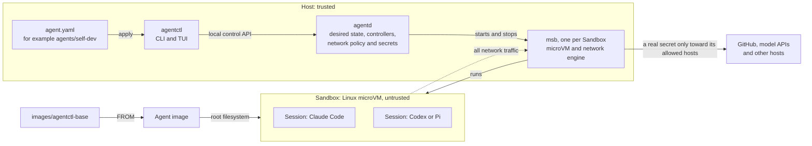

# digdir-agents

Digdir's Agent platform. `agentctl` gives each Agent its own computer: a Linux microVM, called a Sandbox, where
long-running Sessions of Claude Code, Codex or Pi do the work. Network access is mediated on the host, and real secrets
never enter the Sandbox.

The platform has two layers. The Sandbox SDK isolates workloads and knows nothing about Agents, so CI runners and other
isolated workloads can use it too. `agentctl` builds Agents and Sessions on top of it, independent of harness and
model. Hosts can run Linux, macOS or Windows.

## How it fits together



- An **Agent** is declared in an `agent.yaml` manifest: its image, resources, instructions, skills, harnesses,
  environment and secrets. `agentctl apply` hands it to `agentd`, which persists it and reconciles the Agent towards it.
- Each Agent owns one **Sandbox**, a microVM run by its own `msb` process. Its root filesystem and `/home/agent` are
  kept across restarts.
- A **Session** is a durable harness process in tmux inside the Sandbox. Detaching leaves it running, and when it is
  relaunched it resumes its conversation.
- **Secrets stay on the host.** The guest sees a placeholder, and the network engine replaces it with the real value
  only in requests to the hosts the manifest allows.

[`agentctl/docs/architecture`](agentctl/docs/architecture/) has detailed diagrams of the runtime, the crates, the
network and secret mediation, and the path from `agentctl apply` to an attached Session.

## Repository layout

| Path | What it is |
| --- | --- |
| [`agentctl/`](agentctl/) | The `agentctl` CLI and the `agentd` control plane, with installers, an example Agent and the changelog for every release. |
| [`sandbox/`](sandbox/) | The Sandbox SDK and its implementation on Digdir's forks of [microsandbox](https://github.com/digdir/microsandbox) and [libkrunfw](https://github.com/digdir/libkrunfw). |
| [`images/agentctl-base/`](images/agentctl-base/) | Base images that Agent images build on: headless, and desktop with a browser. Both include Claude Code, Codex and Pi. |
| [`agents/self-dev/`](agents/self-dev/) | The Agent that develops this platform, and the reference for new Agents. |
| [`integrations/`](integrations/) | A Slack and GitHub listener from the earlier orchestrator pipeline, kept as a possible entry point to Agents. Nothing consumes its events now. |
| [`docs/presentations/`](docs/presentations/) | Slide decks on `agentctl` and the Sandbox SDK, one of them for security reviewers. |

## Getting started

Install the released `agentctl` and `agentd`, then log in to Claude Code. On Linux or macOS:

```sh
curl -fsSL https://raw.githubusercontent.com/digdir/digdir-agents/main/agentctl/install.sh | sh
agentctl claude login
```

Windows also needs the `HypervisorPlatform` optional feature. See [`agentctl/README.md`](agentctl/README.md) for the
PowerShell installer and for how Agent images are built.

The smallest Agent is [`agentctl/examples/minimal`](agentctl/examples/minimal/). It builds its image from a
Dockerfile, so it needs a running Docker Engine. From that directory:

```sh
agentctl apply --wait          # build the image and start the Agent
agentctl attach session/s1     # start Claude Code in a Session; detach with Ctrl-b d
agentctl tui                   # the same operations in a terminal UI
```

To work on the platform itself, use the self-dev Agent as described in
[`agents/self-dev/README.md`](agents/self-dev/README.md).

## Making a new Agent

Start from [`agents/self-dev`](agents/self-dev/), the Agent in daily use, or from
[`agentctl/examples/minimal`](agentctl/examples/minimal/) for the smallest one that works.

1. Create `agents/<name>/` with an `agent.yaml`. Give the Agent its own `metadata.name`.
2. Base its `Dockerfile` on `ghcr.io/digdir/agentctl-base`, and add only the tools its work needs. While you develop,
   the manifest can build the image from that Dockerfile (`image.type: build`). Publishing it, as
   `agentctl-self-dev-images.yml` does for self-dev, lets others use the Agent without Docker.
3. Write its `instructions.md`. `agentctl` installs that file where each declared harness reads its global
   instructions. Add any skills and `home` overlay files the Agent needs.
4. Declare each secret with the `allowedHosts` it may be sent to, and keep the real values in an env file outside the
   checkout. Pass that file with `agentctl apply --env-file`.
5. Add a `README.md` that says what the Agent is for and how to start it.

Variants such as `agent.nested.yaml` extend a manifest and change only what differs. A new path is sensitive in
[CODEOWNERS](.github/CODEOWNERS) until someone deliberately marks it safe, so a new Agent needs a code owner's review.

## Development

Run `make help` at the repository root for the development commands. `make user-install` builds and installs `agentctl`
and `agentd` for the current user, and `make check` runs the local checks. The architecture rules for contributors and
Agents are in [`agentctl/AGENTS.md`](agentctl/AGENTS.md).

CI runs each area only when its paths change. `ci-gate` in [`ci.yml`](.github/workflows/ci.yml) is the only required
check. User-visible changes go in [`agentctl/CHANGELOG.md`](agentctl/CHANGELOG.md), which is also the source of the
release notes for each `agentctl/v*` release.

## History

Until October 2026 this repository also held an orchestrator pipeline: Agents fed from `integrations/` through a file
contract, an LLM gateway, host scripts and a knowledge base under `doc/`. It is archived as the tag
[`v2.0-pre-cleanup`](https://github.com/digdir/digdir-agents/tree/v2.0-pre-cleanup).
