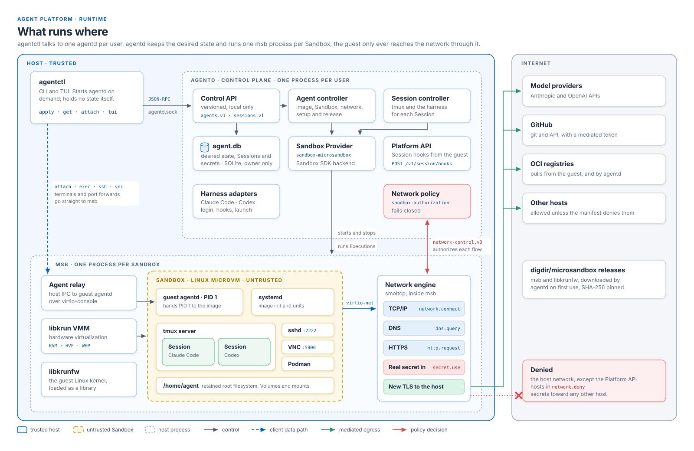
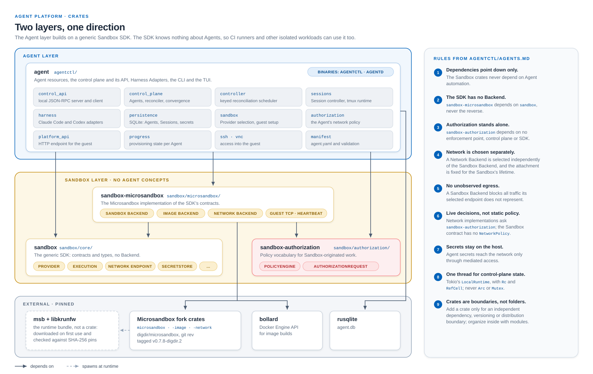
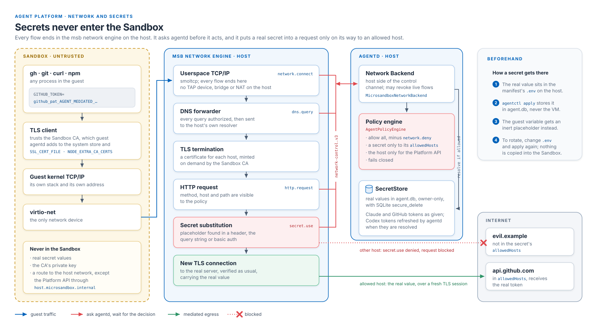
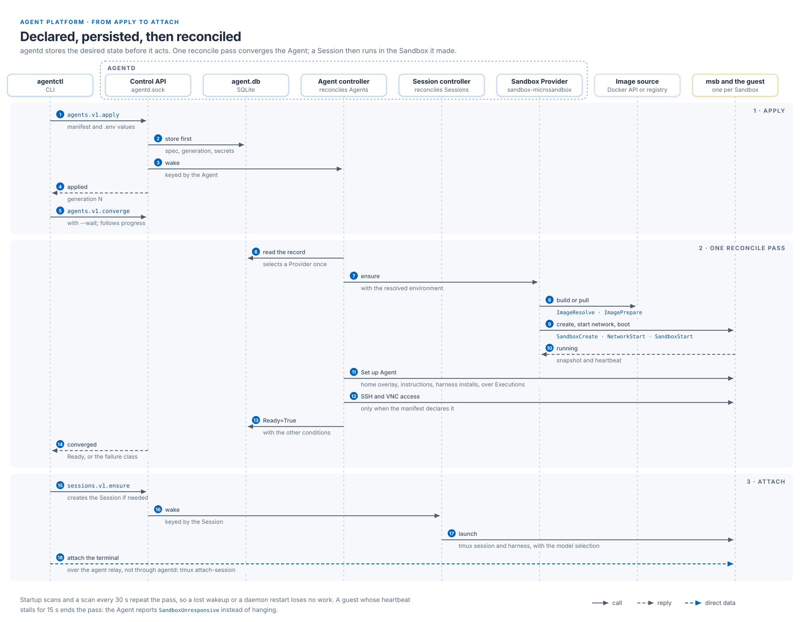

# Architecture diagrams

Diagrams of `agentctl`, `agentd` and the Sandbox crates. [`agentctl/README.md`](../../README.md#architecture) describes
the same architecture in prose.

| Diagram | Shows |
| --- | --- |
| [runtime.svg](runtime.svg) | The processes on the host and in the guest, and what each owns |
| [crates.svg](crates.svg) | The workspace crates, their dependencies and the rules between the layers |
| [network.svg](network.svg) | How guest traffic is mediated and where a secret's real value is used |
| [apply.svg](apply.svg) | What happens from `agentctl apply` to an attached Session |









## Editing

Each diagram is one self-contained, hand-written SVG file, with no build step: edit it and commit it. Every file
carries the same `<style>` block and arrowhead definitions; use its classes rather than inline colours so the diagrams
stay consistent, and change the block in every file when you change it in one. `zone-host` marks the trusted host,
`zone-sandbox` the untrusted guest, `zone-proc` a process boundary and `zone-ext` the Internet.

Text uses Arial and its metric twins (Helvetica, Liberation Sans), so it takes the same width wherever the SVG is shown.
Positions are absolute, so check a changed diagram rendered before you commit it. Reviewers look at the rendered images,
so a pull request that changes a diagram shows them in its description. To render one at twice its size with Chromium:

```sh
chromium --headless --hide-scrollbars --force-device-scale-factor=2 --window-size=1600,1040 \
  --screenshot=runtime.png runtime.svg
```

The window size is the width and height in the SVG's `viewBox`.

Keep a diagram in line with the code it shows; when a change moves a boundary, update the diagram in the same pull
request.
