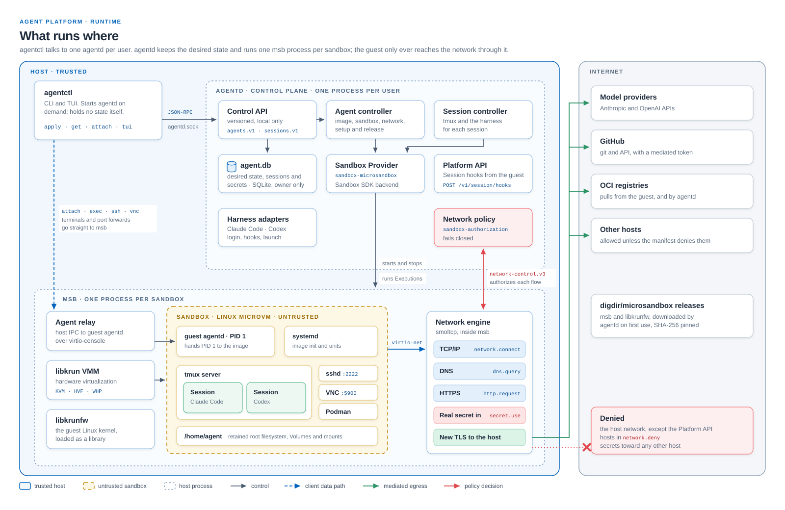
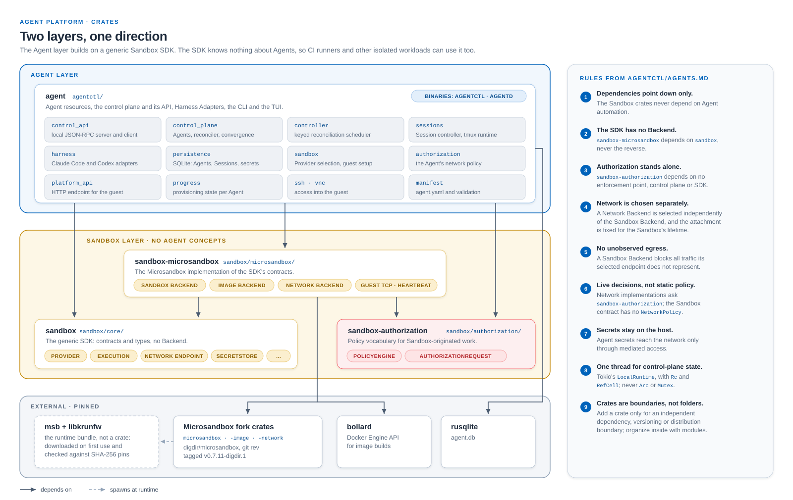
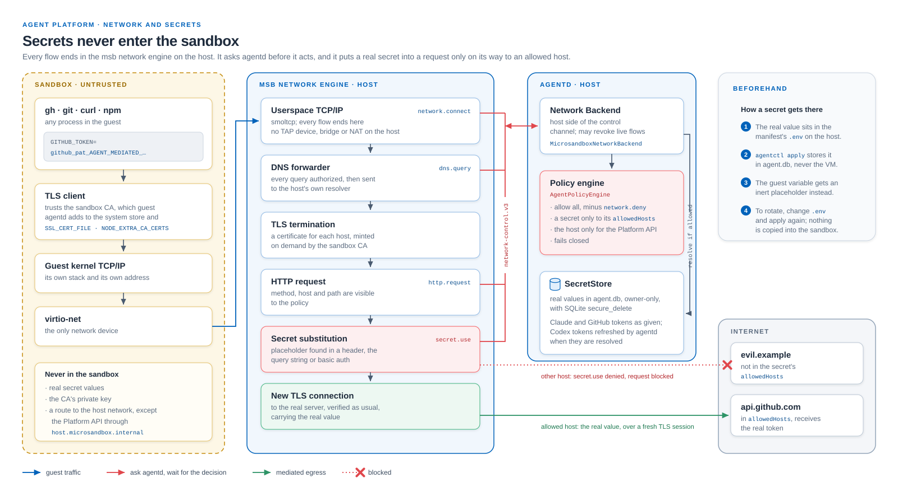
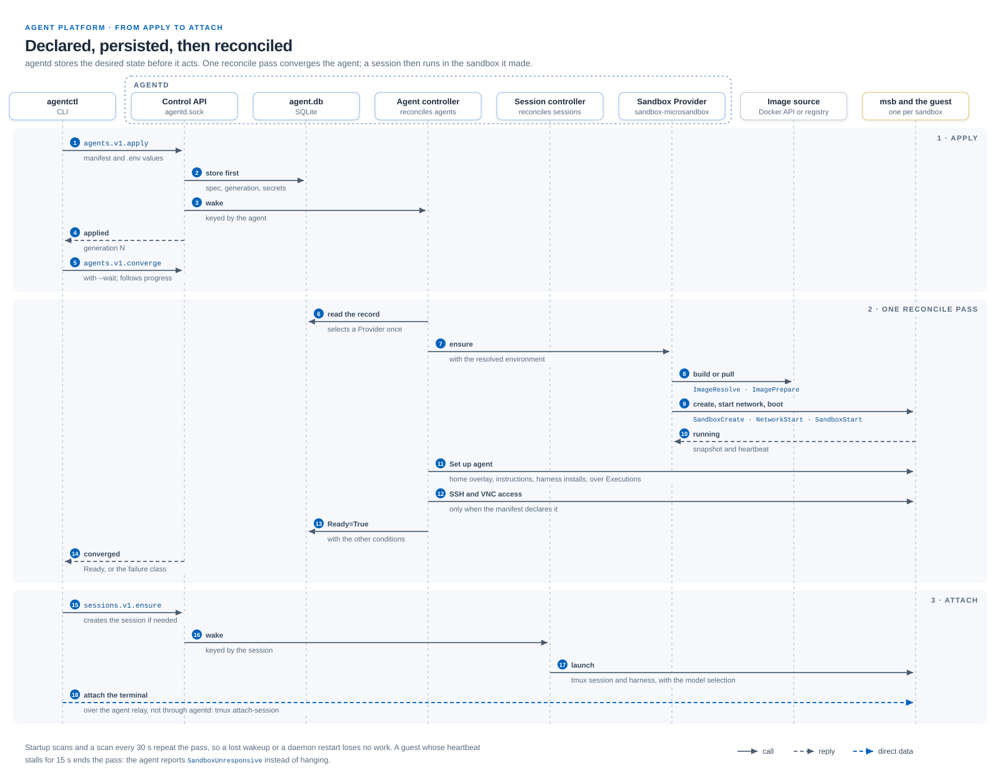

# Architecture

```text
Host
├── agentctl             CLI
└── agentd               daemon: desired state, reconciliation, secrets
    └── Agent            declared in a manifest
        └── Sandbox      isolated, untrusted computer
            ├── Session  one harness
            └── Session  one harness
```

## Principles

- **Building blocks.** Each layer stands on its own and works without the layers above it: the Sandbox SDK without
  Agents, `agentd` without `agentctl`, an Agent without the TUI or any Session. Dependencies only point down, from
  the `agent` crate in [`agentctl/`](../agentctl/) to the Sandbox crates in [`sandbox/`](../sandbox/). A new crate is
  only for code that needs its own dependencies, versioning or distribution. Within a crate, use modules.
- **Local first.** Agents run on people's own machines, on Linux, macOS and Windows, and those machines all differ.
  Supporting them keeps every layer flexible enough to run elsewhere too: `agentd` should fit in a Kubernetes pod given
  nothing more than nested virtualization and `/dev/kvm`, with its configuration and manifests injected.
- **Externals behind adapters.** What we do not own, such as the Sandbox Provider, the operating system in the
  Sandbox, the harnesses and tmux, sits behind an adapter, so we can add, replace or drop it. A new deployment target
  is a new adapter, not a change to the core.
- **Logic in the core.** The core, meaning Agents, Sessions, reconciliation and policy, is where we have leverage and
  where behavior is cheap to test. Adapters translate and stay thin. When in doubt, move logic toward the core.
- **Converge, don't script.** `agentd` stores the desired state before it acts, and reconcilers keep moving towards
  it, repairing what drifts or fails. A lost event, a restart or a Sandbox that stops responding delays an Agent but
  does not break it. For each declared field, `agentd` either fixes it when it creates the Agent or Session and
  refuses later changes, or converges it in place. A failure says whether retrying can help or something has to change
  first.
- **Identities are never reused.** Everything the platform creates gets an identity of its own before it exists, and a
  replacement gets a new one. Names are for people and can come back, but nothing recorded about the old one
  carries over to the new one.
- **One writer per fact.** Desired state, observed state and what a harness reports each have one owner that writes
  them. Anything that combines them is worked out when read, not stored.
- **The Sandbox is untrusted.** We run nothing in it that the host relies on. `agentd` drives the Sandbox from the
  host, and treats what comes out of it as input to check, never as fact.
- **Small attack surface.** Isolation is only as strong as what the Sandbox can touch, so it gets as few devices,
  channels and host endpoints as possible, each added deliberately. Real secrets never enter it, and its network goes
  through the host, where policy fails closed.
- **Long-running.** An Agent is a computer that lives on, with durable Sessions, not a job that runs and ends.

## Diagrams

The processes on the host and in the Sandbox, and what each owns:



The workspace crates, their dependencies and the rules between the layers:



How Sandbox traffic is mediated and where a secret's real value is used:



What happens from `agentctl apply` to an attached Session:


