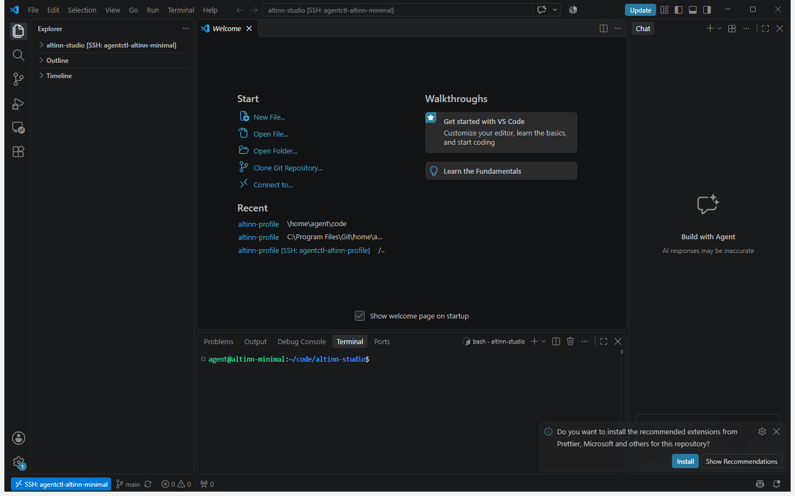
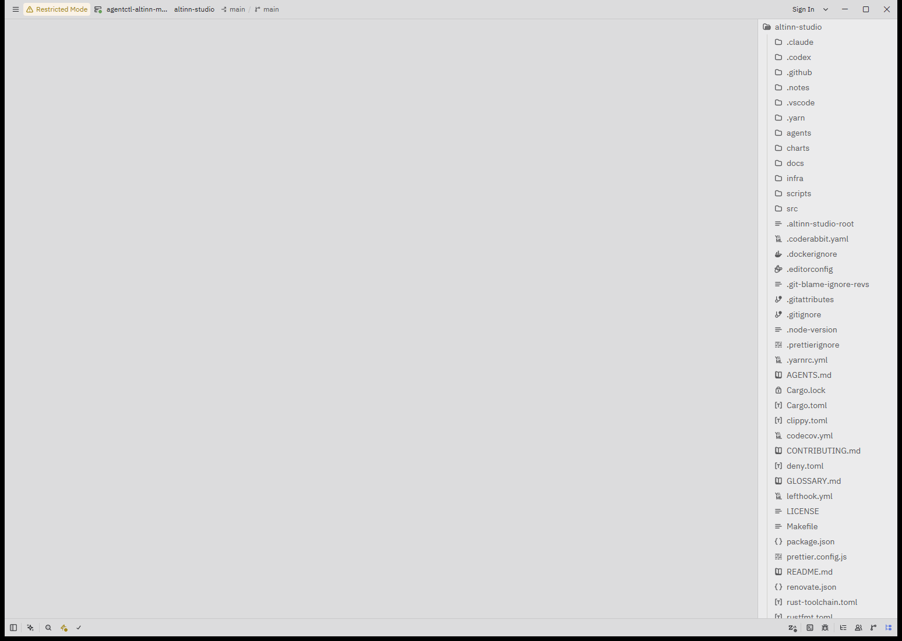

# Open an agent in an editor

How to work in an agent's sandbox from an editor on your own machine. The editor's window runs on the host, and its
files, terminals, language servers and debugger run in the agent, over SSH. The example is
[Altinn/altinn-studio](https://github.com/Altinn/altinn-studio), which keeps its agent definitions in `agents/`.

The steps were run on Windows 11 with a build of `main` at `2d646ba` plus
[#478](https://github.com/digdir/digdir-agents/pull/478), VS Code with Remote - SSH, and Zed.

## Before you start

- `agentctl` 0.1.0-preview.14 or later, and `agentctl claude login`.
- `agentctl github login default`. Without it the agent starts, but clones nothing: see
  [what went wrong](#what-went-wrong-in-the-test).
- A checkout of the repository on the host. It only supplies the agent definition. The agent clones its own copy.

## 1. Create the agent

From the checkout, apply the definition you want. `minimal` suits code and review work:

```sh
cd ~/repos/altinn-studio
agentctl apply -f agents/minimal/agent.yaml --wait
```

```text
agent/altinn-minimal applied
  ✓ Download image layers (1m 37s)
  ✓ Materialize image layers (1m 36s)
  ✓ Assemble root disk (643ms)
  ✓ Pull OCI image (1m 40s)
✓ Resolve sandbox image (1m 40s)
✓ Create sandbox (113ms)
  ✓ Create Microsandbox VM (1.5s)
✓ Start sandbox (1.5s)
  ✓ Install claudeCode instructions and Skills (766ms)
  ✓ Install pi instructions and Skills (767ms)
✓ Set up agent (2.4s)
✓ Configure SSH access (950ms)
agent/altinn-minimal ready
```

`agentctl tui` does the same with `c`. The manifest must declare SSH access, which the altinn-studio definitions do:

```yaml
spec:
  access:
    - type: ssh
```

## 2. Let OpenSSH find the agent

Run this once per machine:

```sh
agentctl ssh-config install
```

It adds one line at the top of `~/.ssh/config`:

```text
Include ~/.agent/ssh/config
```

`agentd` writes that file and keeps it current, with one `Host agentctl-<name>` entry for each agent that has SSH
access. From then on, every agent you create is reachable by its alias with no further setup:

```sh
ssh agentctl-altinn-minimal hostname
```

```text
altinn-minimal
```

`agentctl ssh-info altinn-minimal` prints the alias, the key and the directory editors open:

```text
Type:        ssh
Agent:       altinn-minimal
Alias:       agentctl-altinn-minimal
User:        agent
Directory:   /home/agent/code
Connect:     ssh -F C:\Users\ada\.agent\ssh\config agentctl-altinn-minimal
```

On Windows both OpenSSH clients work: the one Windows ships (`C:\Windows\System32\OpenSSH\ssh.exe`) and the one in
Git for Windows, which Git Bash and a VS Code started from it use. A user folder with `$` in its name, such as
`C:\Users\$AB1234`, needs the build with #478 for Git's `ssh`.

## 3. Open the editor

The quickest way is the TUI: run `agentctl tui`, select the agent and press `o`. The menu offers each editor it
finds on the host:

```text
┌ altinn-minimal · status ────────────────────┐
│Ready:      True                             │
│                                             │
│Connect · o open…                            │
│  shell      in this terminal                │
│  editors    VS Code · Zed                   │
│  ssh alias  agentctl-altinn-minimal         │
└─────────────────────────────────────────────┘
```

`c` opens VS Code, `z` Zed, `s` an SSH shell and `y` copies the alias. The commands below do the same from a shell,
and let you name the folder to open.

### VS Code

Needs the [Remote - SSH](https://marketplace.visualstudio.com/items?itemName=ms-vscode-remote.remote-ssh) extension.

```sh
code --remote ssh-remote+agentctl-altinn-minimal /home/agent/code/altinn-studio
```

The first connection downloads VS Code Server into the agent, which takes about half a minute. The status bar then
shows `SSH: agentctl-altinn-minimal`, and the terminal is a shell in the agent:



Extensions you install in this window run in the agent. Accept the repository's recommended extensions there, not on
the host.

### Zed

```sh
zed ssh://agentctl-altinn-minimal/home/agent/code/altinn-studio
```



Zed opens a remote project in restricted mode until you trust it.

### JetBrains IDEs

Rider, IntelliJ IDEA and the other JetBrains IDEs connect through
[JetBrains Gateway](https://www.jetbrains.com/remote-development/gateway/), which installs the IDE's backend in the
agent. `agentctl` does not launch Gateway yet ([#370](https://github.com/digdir/digdir-agents/issues/370)), so set it
up by hand:

1. In Gateway, choose **SSH** and **New Connection**, and add a connection with host `agentctl-altinn-minimal`, user
   `agent`, and authentication type **OpenSSH config and authentication agent**. Gateway then takes the proxy
   command and the key from the same SSH configuration as the other editors.
2. Pick the IDE and the project folder, `/home/agent/code/altinn-studio`.

Give the agent room for the backend first. Rider's backend took 6.6 GB of disk and about 3.6 GB of memory with a
solution open, so use a personal variant with more memory, as [below](#give-your-editor-more-room). This flow was
tested on 2026-11-01 with Rider on Altinn/altinn-notifications, not with this build: the findings are in
[#370](https://github.com/digdir/digdir-agents/issues/370#issuecomment-6574610657). Gateway's first connect to a new
agent can time out, and a second attempt connects.

### Apps that run a harness over SSH

The Claude and ChatGPT desktop apps, T3 Code and the Agents window of VS Code Insiders start their own harness on a
remote host over SSH. Give them the same alias, `agentctl-altinn-minimal`.

## 4. Work alongside the agent's sessions

The editor and the agent's sessions share one computer. A session you start with `agentctl attach`, the TUI or an
orchestrator edits the same checkout the editor shows, so the editor is where you read a diff as it grows, set a
breakpoint in what the agent wrote, or run one test again.

```sh
agentctl attach session/fix-login --agent altinn-minimal   # a harness session in the agent
agentctl ssh altinn-minimal                                # a plain shell beside it
agentctl exec agent/altinn-minimal -- nproc                # one command, without a shell
```

Ports the agent listens on stay in the sandbox. VS Code forwards a port from its **Ports** panel, and
`agentctl port-forward altinn-minimal 3000:3000` does it from a shell.

## Give your editor more room

The team's manifest is sized for the harness. Keep your own choices in a variant beside it that Git ignores, such as
`agents/minimal/agent.mine.yaml`:

```yaml
apiVersion: agents.platform/v1alpha1
kind: AgentVariant
extends: agent.yaml
metadata:
  name: altinn-minimal-mine
spec:
  sandbox:
    resources:
      cpu: "6"
      memory: "16Gi"
```

```sh
agentctl apply --variant mine --wait
```

## Stop and remove

```sh
agentctl stop agent/altinn-minimal     # keeps the disk; `agentctl start` resumes it
agentctl delete agent/altinn-minimal   # removes the agent, its disk and its sessions
```

## What went wrong in the test

- **Without a GitHub login the agent has no checkout.** `agentctl apply --wait` ended with `ready`, but
  `agent-workspace-init.service` had failed, `~/code` was empty and `systemctl is-system-running` said `degraded`.
  The repository is public, so an anonymous clone would have worked. Nothing in `apply`, `describe` or the TUI said
  that the login was missing or that the clone had failed. Until that is fixed, check with
  `agentctl exec agent/altinn-minimal -- systemctl --failed`. A running agent gets the token at the next reconcile
  after `agentctl github login default`, so `gh auth status` turns good by itself, but the clone is not tried again.
  `agentctl restart agent/altinn-minimal` runs it: after the restart the agent had the full clone, with the
  account's name as Git's `user.name`, and `systemctl is-system-running` said `running`.
