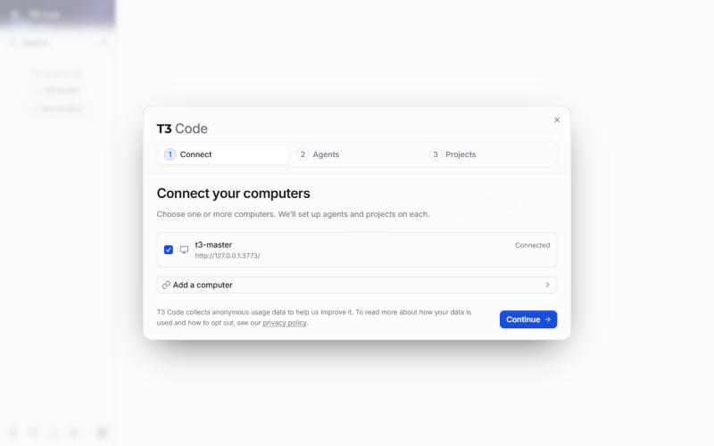
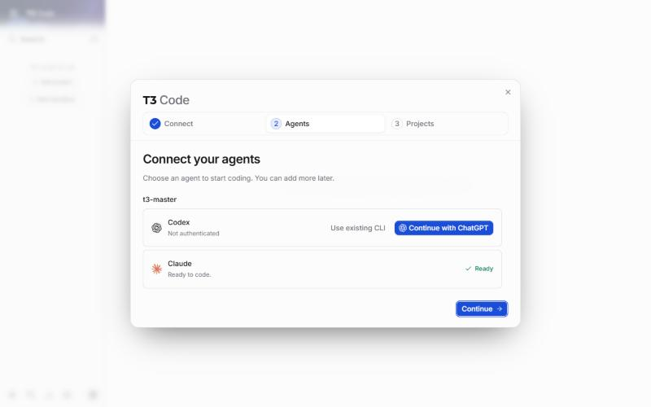
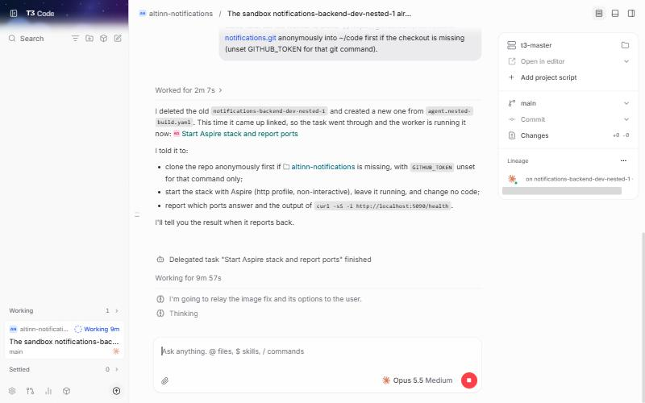
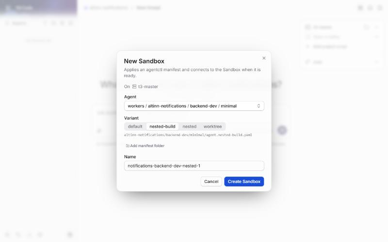

# Run a T3 orchestrator in an agent

How to run [T3 Code](https://github.com/martinothamar/t3code) as an orchestrator in a sandbox of its own, and give
it repositories to work on. T3 Code's server and web client run in one agent, `t3-master`. The agents it hands work
to are nested agents of that one, made from each repository's own agent definition. The host runs only `agentctl`
and a browser: no T3 Code, no harness and no login of its own for either.

```text
host                         agent/t3-master                         nested agents
────                         ───────────────                         ─────────────
browser ── port-forward ──▶  T3 Code server :3773
                             agentctl + agentd ── creates ─────────▶ notifications-backend-dev-1
agentctl ── ssh ──────────▶  ~/code/<repository>      (projects)     profile-backend-dev-1
t3-join ── copies ────────▶  ~/workers/<repository>   (definitions)
```

The steps were run on Windows 11 with a build of `main` at `2d646ba` plus
[#478](https://github.com/digdir/digdir-agents/pull/478). The definition is [agents/t3-master](../../agents/t3-master/).

## Before you start

- `agentctl`, `agentctl claude login` and `agentctl github login default`.
- Docker on the host, which builds the orchestrator's image.
- A host that gives sandboxes nested virtualization: Linux x86_64 with nested KVM, an Apple M3 or newer on macOS 15
  or newer, or Windows with the `HypervisorPlatform` feature. The manifest sets `nestedSandboxes: required`, so
  `agentd` refuses to start it elsewhere.
- Room for it: 10 CPUs, 24 GiB of memory and up to 160 GiB of disk as the manifest is written. Lower them in a
  variant when you run fewer or smaller workers.
- The T3 Code build. The fork's build with `delegate_task` to sandboxes has no release yet, so the definition takes
  it from `agents/t3-master/home/.local/share/t3-build/`, which Git ignores. Put
  `t3-0.1.6-preview.20261102.3-linux-x64.tar.gz` there.

## 1. Start the orchestrator

```sh
agentctl apply -f agents/t3-master/agent.yaml --wait --timeout 40m
```

```text
agent/t3-master applied
  ✓ Build Docker image (2m 03s)
  ✓ Export Docker image (18.1s)
  ✓ Materialize image layers (1.5s)
  ✓ Import Microsandbox image (3.1s)
✓ Resolve sandbox image (2m 25s)
✓ Create sandbox (109ms)
  ✓ Materialize direct root image (7.3s)
  ✓ Create Microsandbox VM (5.1s)
✓ Start sandbox (12.5s)
  ✓ Prepare workspace and Podman (1.5s)
  ✓ Sync home (1.7s)
✓ Set up agent (3.9s)
✓ Configure SSH access (1.3s)
agent/t3-master ready
```

At boot the `t3-server` service installs the T3 Code build, passes this agent's Claude Code login and GitHub
account on to the `agentd` inside it, and starts the server on the agent's own `127.0.0.1:3773`. Check it:

```sh
agentctl ssh t3-master -- systemctl status t3-server --no-pager
agentctl ssh t3-master -- agentctl claude list
```

```text
● t3-server.service - T3 Code server and web client on the guest loopback
     Active: active (running)
             ├─ 687 /home/agent/.local/opt/t3/t3-0.1.6-preview.20261102.3-linux-x64/t3 serve --host 127.0.0.1 --port 3773 --base-dir /home/agent/.t3
             ├─ 877 /usr/local/bin/agentd --home /home/agent/.agent
NAME     STORED  AGENTS
default  yes     -
```

## 2. Open the web client

Forward the port, and leave the command running:

```sh
agentctl port-forward t3-master 127.0.0.1:3773:3773
```

A browser that has not been here before must be paired. Mint a link in the agent and open it on the host:

```sh
agentctl ssh t3-master -- t3 pair --ttl 30m --label host-browser
```

```text
Pairing with t3-master (http://127.0.0.1:3773).
Pairing URL: http://127.0.0.1:3773/pair#token=…
```

The welcome steps show the one computer T3 Code runs on, and Claude as ready on the login the host mediates:





Skip the project import. The orchestrator starts empty.

## 3. Join a repository

A repository joins the orchestrator with its agent definition. Make one first when it has none, as
[Add an agent to a repository](add-an-agent-to-a-repository.md) describes. Then, from a checkout on the host:

```sh
agents/t3-master/t3-join ~/repos/altinn-notifications-agent
```

```text
Copying the agent definitions of Altinn/altinn-notifications to agent/t3-master:~/workers/altinn-notifications
Cloning Altinn/altinn-notifications into agent/t3-master:~/code/altinn-notifications
Adding altinn-notifications as a project in T3 Code
Added project c53e7ebb-e259-48b6-b928-c79336713c0e (altinn-notifications) at /home/agent/code/altinn-notifications.
Worker manifests T3 Code now offers:
/home/agent/workers/altinn-notifications/backend-dev/minimal/agent.nested-build.yaml
/home/agent/workers/altinn-notifications/backend-dev/minimal/agent.nested.yaml
/home/agent/workers/altinn-notifications/backend-dev/minimal/agent.worktree.yaml
/home/agent/workers/altinn-notifications/backend-dev/minimal/agent.yaml
```

`t3-join` is a shell script, so on Windows run it from Git Bash. It does three things over `agentctl ssh`:

1. copies the checkout's `agents/` folder to `~/workers/<repository>` in the orchestrator, committed or not, without
   any `.env` file. T3 Code offers every manifest under `~/workers` when it creates a sandbox.
2. clones the repository into `~/code/<repository>` there.
3. adds that clone as a project in T3 Code, with `t3 project add`.

Run it again after you change the definition. Join each repository the work spans. The orchestrator's threads then
see all of them side by side in `~/code`.

## 4. Start a thread

Open the repository's project and describe the task. A thread runs in `t3-master`, where it reads and plans in
`~/code/<repository>`. For work that needs the repository's toolchain it creates a worker from the repository's
definition with the `t3_sandbox_create` tool and hands it the task with `delegate_task`, as the orchestrator's
[instructions](../../agents/t3-master/instructions.md) tell it. A task such as:

> Create a sandbox with t3_sandbox_create from
> ~/workers/altinn-notifications/backend-dev/minimal/agent.nested-build.yaml with wait: true. Then delegate this to
> it: in ~/code/altinn-notifications, start the whole stack with Aspire as the agent's instructions describe, leave
> it running, and report which ports answer, with the output of curl against the API's /health on port 5090. Do not
> change any code.

Name a variant sized to run inside the orchestrator:

- `nested`, when CI has published the definition's image.
- `nested-build`, before that. The `agentd` in the orchestrator builds the image there with Podman, which takes
  several minutes the first time.

The thread shows the delegated task in its **Lineage** panel, and wakes when the worker reports back:



```text
I deleted the old notifications-backend-dev-nested-1 and created a new one from agent.nested-build.yaml. This time
it came up linked, so the task went through and the worker is running it now: Start Aspire stack and report ports

Delegated task "Start Aspire stack and report ports" finished

The worker reported back, and the stack is not running. Only PostgreSQL is up. Aspire fails while building its
AppHost, before any service starts. The worker changed no code.

Why: the AppHost pins Aspire 13.6.4. That version now has a high-severity advisory (GHSA-f7vh-h5g3-7jrh).
Directory.Build.props sets TreatWarningsAsErrors, so the package restore stops on that warning:

  apphost.cs.csproj : error NU1903: Warning As Error: Package 'Aspire.Hosting' 13.6.4 has a known high severity
  vulnerability

Next steps (each needs your go-ahead):
- Bump the pin to Aspire 13.6.5, which the worker says is out. This is the likely real fix, but it changes repo code.
- Turn off NuGet's vulnerability check for this run only. This changes no code, but it hides a real security
  warning. The worker chose not to do it.
```

That is the loop: the thread delegates, the worker does the work with the repository's tools and reports what it
found, and the thread comes back to you with the decision that is yours. The answer in the test was the first
option, on a local branch with no push. Nine minutes later the thread reported commit `b5d4412f` on the worker's
branch, the stack running, and `/health` answering `200 Healthy` on port 5090.

From the host, the worker is two hops away:

```sh
agentctl ssh t3-master -- agentctl get agents
```

```text
NAME                                READY  STATUS        HARNESSES                    PROVIDER
notifications-backend-dev-nested-1  True   SandboxReady  claudeCode (default), codex  microsandbox
```

### The New Sandbox dialog

**New Sandbox** in the sidebar creates a sandbox from the same manifests without a thread. **Agent** lists the
definitions of the joined repositories, and **Variant** the manifests of the one you pick:



A sandbox made this way is not linked for delegation: in the test a thread that was asked to delegate to it answered that its `delegation` field was empty,
and had to delete it and create its own. Let the thread create the workers it delegates to.

[Work with agents](work-with-agents.md) describes the day-to-day loop from here: following the workers, inspecting
them from an editor or a shell, and testing against what they run.

## Stop and resume

```sh
agentctl stop agent/t3-master      # stops the orchestrator and every worker in it; disks are kept
agentctl start agent/t3-master
```

After a start, run the `port-forward` again. T3 Code's threads are on the orchestrator's disk, so they are still
there. `agentctl delete agent/t3-master` removes them with the workers.

## What is not there yet

- **`agentctl t3 join`.** `t3-join` is a script beside the definition. As a command, `agentctl t3 join <checkout>`
  would also find the orchestrator, check the definition has a nested variant, and tell T3 Code to rescan.
- **Joining an agent that already runs.** An agent on the host is a sibling of `t3-master`, and a sandbox cannot
  reach its siblings until agents can be peers ([#278](https://github.com/digdir/digdir-agents/issues/278)). Only
  workers the orchestrator creates itself can take delegated tasks.
- **A released T3 Code build.** The build comes from a local archive, and T3 Code installs its published server
  `0.1.6-preview.20261101.39` in the workers.
- **A change to the definition needs a new agent.** `agentd` does not rebuild an image when its Dockerfile changes.
  Delete and apply `t3-master` again, which also deletes its threads.

## What went wrong in the test

- **The host had no GitHub login.** The orchestrator and its workers started without one, and every worker's
  boot-time clone failed, as in [Open an agent in an editor](open-an-agent-in-an-editor.md#what-went-wrong-in-the-test).
  The thread told the worker to clone anonymously. With `agentctl github login default` on the host, the
  orchestrator passes the account on.
- **The orchestrator's copy of a definition goes stale.** The definition was still changing while workers were made
  from it, and two workers failed to build on a Dockerfile that had since been fixed. `t3-join` copies, so run it
  again after every change.
- **A build fails when the Ubuntu mirrors do not resolve.** During the test the host's DNS stopped answering for
  `archive.ubuntu.com`. The `agentd` in the orchestrator kept retrying and built the worker when it came back, with
  no one asking.
- **A sandbox from the New Sandbox dialog cannot take delegated tasks**, as [step 4](#the-new-sandbox-dialog) says.
