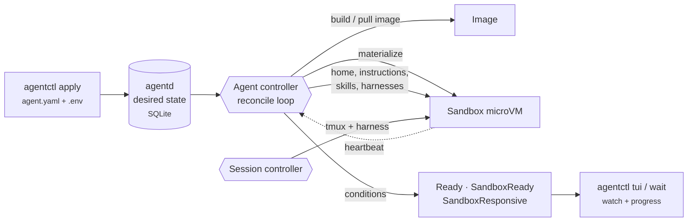
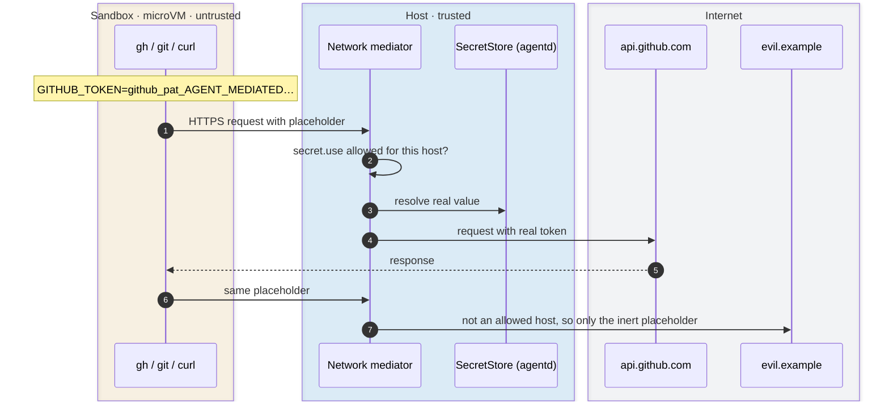
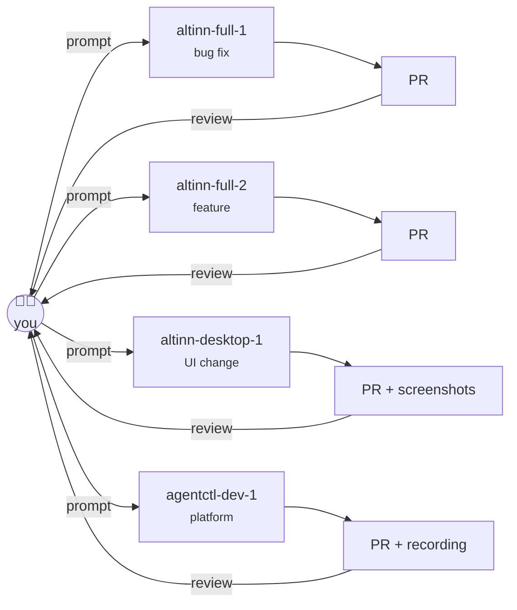
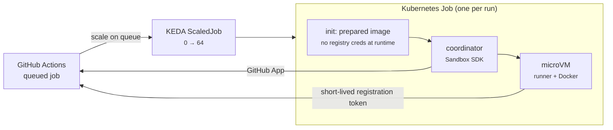

<div class="kicker">digdir/digdir-agents</div>

# Agents with their own computer

<div class="text-2xl muted mt-2">agentctl and the Sandbox SDK</div>

<div class="accent-bar mt-8"><span /><span /><span /><span /></div>

<div class="absolute bottom-10 left-14 text-sm muted">
Altinn Studio · DevOps
</div>

---

<div class="kicker">The starting point</div>

# Coding agents on your laptop

<div class="grid grid-cols-3 gap-5 mt-10">
  <div class="card" v-click>
    <div class="text-3xl mb-3">🔑</div>
    <h3>Your credentials</h3>
    <p>The agent runs as you. Your tokens, your SSH keys, your cloud logins and your company network.</p>
  </div>
  <div class="card" v-click>
    <div class="text-3xl mb-3">✋</div>
    <h3>Permission prompts</h3>
    <p>Approve every command and you babysit the agent. With auto mode or no prompts, you trust it with your machine.</p>
  </div>
  <div class="card" v-click>
    <div class="text-3xl mb-3">🧍</div>
    <h3>One at a time</h3>
    <p>Worktrees split the code, but there is still one set of ports, one Docker daemon and one localtest. A second agent means conflicts.</p>
  </div>
</div>

<div v-click class="mt-10 text-xl">
Either <span class="c-coral font-semibold">you</span> do the verification, or you let the agent take more risks with <span class="c-coral font-semibold">your</span> machine.
</div>

---
layout: center
---

<div class="kicker text-center">The idea</div>

<div class="big-quote text-center max-w-4xl">
Give every agent <span class="c-sky">its own computer</span>, <br/>
with root, tools and network access, <br/>
but <span class="c-coral">none of your secrets</span>.
</div>

<div class="text-center text-lg muted mt-6">
The host keeps the secrets and decides <span class="text-white font-semibold">where each one may be sent</span>.
</div>

<div class="flex justify-center gap-3 mt-10">
  <span class="tag blue">microVM per agent</span>
  <span class="tag coral">mediated secrets</span>
  <span class="tag amber">declarative manifests</span>
  <span class="tag green">any harness, any model</span>
</div>

---
layout: section
---

<div class="kicker">Part 1</div>

# Architecture

---

<div class="kicker">Architecture</div>

# Two layers, one repo

<div class="grid grid-cols-[1fr_1.1fr] gap-10 mt-6">

<div class="flex flex-col gap-3">
  <div class="box blue">
    <div class="title">Agent layer · <code>agentctl</code> + <code>agentd</code></div>
    <div class="sub">Agents, Sessions, harness adapters, control API, TUI, secret store</div>
  </div>
  <div class="text-center muted text-xs">builds on ↓</div>
  <div class="box amber">
    <div class="title">Sandbox SDK · <code>sandbox</code></div>
    <div class="sub">Lifecycle, images, exec, files, terminals, network backends. No agent concepts.</div>
  </div>
  <div class="grid grid-cols-2 gap-3">
    <div class="box">
      <div class="title text-sm">sandbox-microsandbox</div>
      <div class="sub">Backend + network enforcement</div>
    </div>
    <div class="box">
      <div class="title text-sm">sandbox-authorization</div>
      <div class="sub">Context-aware policy vocabulary</div>
    </div>
  </div>
  <div class="box coral">
    <div class="title">Microsandbox + libkrun</div>
    <div class="sub">microVMs (KVM / Hypervisor.framework / WHP), Digdir forks</div>
  </div>
</div>

<div class="text-[0.95rem] leading-relaxed">

- Written in **Rust**, **local first** on Linux, macOS and Windows
- Every Sandbox is a **real VM** with its own kernel, not a container
- The SDK is **generic** and reused outside agentctl:

<div class="flex flex-col gap-2 mt-3 ml-4">
  <div v-click class="box dashed"><span class="title">agentctl</span> <span class="sub">· local agents</span></div>
  <div v-click class="box dashed"><span class="title">GitHub runner</span> <span class="sub">· altinn-studio CI</span></div>
  <div v-click class="box dashed"><span class="title">Studio assistant</span> <span class="sub">· opportunity</span></div>
</div>

</div>
</div>

---

<div class="kicker">Architecture · principle</div>

# Local first as a forcing function

<div class="grid grid-cols-[1fr_1.25fr] gap-10 mt-4">

<div>

<v-clicks>

- Good architecture keeps **dependencies and coupling** to a minimum
- Three host OSes, three hypervisors, no cloud: the lower layers **have to** stay flexible
- Nothing in the SDK knows about agents, Kubernetes or a vendor
- Cloud is just **another host**: complexity that belongs to Kubernetes stays in Kubernetes

</v-clicks>

</div>

<div class="flex flex-col gap-3">
  <div class="grid grid-cols-3 gap-3">
    <div class="box"><div class="title text-sm">Linux</div><div class="sub">KVM</div></div>
    <div class="box"><div class="title text-sm">macOS</div><div class="sub">Hypervisor.framework</div></div>
    <div class="box"><div class="title text-sm">Windows</div><div class="sub">Hypervisor Platform</div></div>
  </div>
  <div class="box amber text-center"><div class="title">Same Sandbox SDK · same microVM</div></div>
  <div class="box blue" v-click>
    <div class="flex items-center justify-between mb-2"><span class="title">Kubernetes node</span><span class="tag blue">no privileged pods</span></div>
    <div class="grid grid-cols-2 gap-3">
      <div class="box"><div class="title text-xs">Device plugin</div><div class="sub">exposes standard <code>/dev/kvm</code></div></div>
      <div class="box"><div class="title text-xs">Pod</div><div class="sub">asks for it like CPU or memory</div></div>
    </div>

```yaml
resources:
  limits:
    devices.altinn.studio/kvm: "1"   # already used by the GitHub runner
securityContext:
  privileged: false
```

  </div>
</div>

</div>

---

<div class="kicker">Architecture</div>

# Host, Agent, Sandbox, Session

<div class="grid grid-cols-[1.25fr_1fr] gap-10 mt-4 items-start">

<div class="relative">
  <div class="box" style="padding: 0.9rem">
    <div class="flex items-center justify-between mb-3">
      <span class="title">💻 Your machine</span><span class="tag">host</span>
    </div>
    <div class="grid grid-cols-2 gap-3 mb-3">
      <div class="box blue"><div class="title">agentctl</div><div class="sub">CLI · TUI · attach · ssh</div></div>
      <div class="box blue"><div class="title">agentd</div><div class="sub">control plane · reconcile · SecretStore</div></div>
    </div>
    <div class="box coral" v-click>
      <div class="flex items-center justify-between mb-2">
        <span class="title">Agent <code>altinn-desktop</code></span><span class="tag coral">declarative resource</span>
      </div>
      <div class="box amber">
        <div class="flex items-center justify-between mb-2">
          <span class="title">Sandbox · microVM</span><span class="tag amber">own kernel, root, disk</span>
        </div>
        <div class="grid grid-cols-3 gap-2">
          <div class="box green" v-click><div class="title text-xs">Session s1</div><div class="sub">Claude Code</div></div>
          <div class="box green" v-after><div class="title text-xs">Session s2</div><div class="sub">Codex</div></div>
          <div class="box green" v-after><div class="title text-xs">ssh / VS Code</div><div class="sub">T3 Code, Zed…</div></div>
        </div>
      </div>
    </div>
  </div>
</div>

<div class="text-[0.92rem] leading-relaxed">

<v-clicks>

- **agentd** owns desired state and reconciles it, like a tiny Kubernetes controller
- An **Agent** owns one retained **Sandbox**: disk, volumes and identity survive restarts
- **Sessions** are durable harness processes in tmux. Detach, go idle, resume the conversation later

</v-clicks>

</div>
</div>

---

<div class="kicker">Architecture</div>

# Declarative, reconciled



<div class="grid grid-cols-3 gap-4 mt-2 text-sm">
  <div class="card"><h3>State, not streams</h3><p>Progress is folded state. A late observer sees the same thing as an early one.</p></div>
  <div class="card"><h3>Survives restarts</h3><p>Desired state is persisted first. Periodic scans pick up lost wakeups.</p></div>
  <div class="card"><h3>Stalls are visible</h3><p>Guest heartbeat stops for 15 s → <code>SandboxUnresponsive</code>, never a silent hang.</p></div>
</div>

---

<div class="kicker">Architecture · Security</div>

# Secrets never enter the Sandbox



<div class="text-sm muted mt-1 text-center">
Fails closed · Rotate the token without touching the VM · Per-secret <code>allowedHosts</code> · No path to the host network
</div>

---

<div class="kicker">Architecture · Security</div>

# Every layer goes through the host

<div class="grid grid-cols-[0.85fr_auto_1.6fr] gap-5 mt-2 items-stretch">

<div class="box amber flex flex-col gap-2" style="padding: 0.8rem">
  <div class="flex items-center justify-between"><span class="title">Sandbox</span><span class="tag amber">untrusted</span></div>
  <div class="box"><div class="title text-xs">gh · git · curl · npm</div><div class="sub">sees a placeholder token</div></div>
  <div class="box"><div class="title text-xs">TLS client</div><div class="sub">trusts the Sandbox CA</div></div>
  <div class="box"><div class="title text-xs">Guest kernel TCP/IP</div><div class="sub">its own stack, its own IP</div></div>
  <div class="box"><div class="title text-xs">virtio-net</div><div class="sub">the only network device</div></div>
</div>

<div class="flex flex-col items-center justify-center gap-1 text-xs muted">
  <div class="text-2xl c-sky">⇄</div>
  <div>Ethernet</div>
  <div>frames</div>
  <div class="tag blue mt-1">L2</div>
</div>

<div class="box blue flex flex-col gap-2" style="padding: 0.8rem">
  <div class="flex items-center justify-between"><span class="title">Host · Microsandbox runtime</span><span class="tag blue">trusted</span></div>
  <div class="grid grid-cols-[3.2rem_1fr_auto] gap-x-3 gap-y-2 items-center text-sm">
    <span class="tag">L2</span>
    <div><span class="title text-xs">Frames into userspace</span> <span class="sub">· no TAP, bridge or NAT on the host</span></div>
    <span></span>
    <span class="tag">L3/L4</span>
    <div><span class="title text-xs">smoltcp TCP/IP stack</span> <span class="sub">· every flow ends here</span></div>
    <code class="text-xs">network.connect</code>
    <span class="tag">DNS</span>
    <div><span class="title text-xs">DNS interception</span> <span class="sub">· names and record types</span></div>
    <code class="text-xs">dns.query</code>
    <span class="tag">L7</span>
    <div><span class="title text-xs">TLS terminated</span> <span class="sub">· per-domain cert from the Sandbox CA</span></div>
    <code class="text-xs">http.request</code>
    <span class="tag coral">secret</span>
    <div><span class="title text-xs">Placeholder → real value</span> <span class="sub">· only for allowed hosts</span></div>
    <code class="text-xs">secret.use</code>
    <span class="tag green">out</span>
    <div><span class="title text-xs">New TLS connection</span> <span class="sub">· to the real server</span></div>
    <span></span>
  </div>
</div>

</div>

<div class="grid grid-cols-3 gap-4 mt-3 text-sm">
  <div class="card"><h3>One policy vocabulary</h3><p><code>sandbox-authorization</code> for every check.</p></div>
  <div class="card"><h3>Context-aware</h3><p>Hostname, method, path, secret location.</p></div>
  <div class="card"><h3>Fails closed</h3><p>No policy or secret means nothing goes out.</p></div>
</div>


---
class: tight
---

<div class="kicker">Architecture · Open question</div>

# Which identity does an agent act as?

<div class="grid grid-cols-[1.2fr_1fr] gap-6 mt-2">

<div class="flex flex-col gap-2">
  <div class="card"><h3>Fine-grained PAT</h3><p>Per repository and permission, expires. Tied to a person, so it stops when they leave.</p></div>
  <div class="card"><h3>Classic PAT</h3><p>Broad scopes across every repo the person can reach. Hard to limit.</p></div>
  <div class="card"><h3>GitHub App</h3><p>Short-lived installation tokens, owned by the org. Built for bots, but needs an admin to set up.</p></div>
  <div class="card"><h3>Own user or a bot account</h3><p>Simple. A bot account is a seat that needs collaborator access, which also decides who can open PRs.</p></div>
</div>

<div class="flex flex-col gap-2" v-click>
  <div class="box coral" style="padding: 0.7rem">
    <div class="title text-sm">A real run</div>
    <div class="sub mt-1">An agent signed in as a separate bot account, with read-only access to the repository. It forked the repo and tried to open the PR from the fork. GitHub refused: only collaborators may open PRs there. Access was granted afterwards and the PR went through.</div>
  </div>
  <div class="box amber" style="padding: 0.7rem">
    <div class="title text-sm">Unsolved for us</div>
    <div class="sub mt-1">Which option should Altinn use for agents? One identity per agent, one per team, or the person who started the task? Who grants and reviews the access?</div>
  </div>
</div>

</div>


---

<div class="kicker">Architecture · Security · honest limits</div>

# What the Sandbox doesn't protect against

<div class="grid grid-cols-2 gap-8 mt-4">

<div class="flex flex-col gap-3">
  <div class="flex items-center justify-between"><span class="title">Protected</span><span class="tag green">by design</span></div>
  <div class="box green"><div class="title text-sm">Your machine</div><div class="sub">the agent has root only inside its own VM</div></div>
  <div class="box green"><div class="title text-sm">Secret values</div><div class="sub">never in the VM, only sent to their allowed hosts</div></div>
  <div class="box green"><div class="title text-sm">Other agents</div><div class="sub">separate VMs, disks and networks</div></div>
  <div class="box green"><div class="title text-sm">The host network</div><div class="sub">only the Platform API is reachable</div></div>
</div>

<div class="flex flex-col gap-3" v-click>
  <div class="flex items-center justify-between"><span class="title">Not protected</span><span class="tag coral">needs other controls</span></div>
  <div class="box coral"><div class="title text-sm">Misuse of a token on its own hosts</div><div class="sub">anything the PAT allows on github.com, including a public gist</div></div>
  <div class="box coral"><div class="title text-sm">Data leaving without secrets</div><div class="sub">with <code>allow: all</code>, code can be posted to any host</div></div>
  <div class="box coral"><div class="title text-sm">Prompt injection</div><div class="sub">issues, web pages and dependencies can steer the agent</div></div>
  <div class="box coral"><div class="title text-sm">Bad code</div><div class="sub">review is still the gate, not the Sandbox</div></div>
  <div class="box coral"><div class="title text-sm">Sessions in one Sandbox</div><div class="sub">same user and tmux server, so one trust boundary</div></div>
</div>

</div>

<div class="mt-4 text-sm muted text-center" v-click>
Narrow tokens, tighter <code>allow</code> lists and review shrink the gap. The policy engine is where stricter rules can go.
</div>

---

<div class="kicker">Architecture</div>

# Harness-neutral

<div class="grid grid-cols-2 gap-8 mt-8">

<div>

The platform doesn't care which agent runs inside.

<div class="flex flex-col gap-3 mt-6">
  <div class="box blue"><span class="title">Claude Code</span> <span class="sub">· mediated login, hooks, resume</span></div>
  <div class="box blue"><span class="title">Codex CLI</span> <span class="sub">· mediated ChatGPT login</span></div>
  <div class="box dashed"><span class="title">Your harness</span> <span class="sub">· adapter: auth, config, launch, transcripts</span></div>
</div>

</div>

<div v-click>

**Or bring your own UI over SSH.**<br/><code>agentctl-&lt;name&gt;</code> is a plain OpenSSH alias.

<div class="grid grid-cols-2 gap-3 mt-6">
  <div class="card"><h3>T3 Code</h3><p>Sandboxes as environments</p></div>
  <div class="card"><h3>VS Code / Zed</h3><p>Remote-SSH into the VM</p></div>
  <div class="card"><h3>Claude desktop</h3><p>Remote sessions</p></div>
  <div class="card"><h3>ChatGPT desktop</h3><p>Remote sessions</p></div>
</div>

</div>
</div>

---
layout: section
---

<div class="kicker">Part 2</div>

# What is an agent definition?

---

<div class="kicker">Agent definition</div>

# A folder in your repo

<div class="grid grid-cols-[1fr_1.2fr] gap-10 mt-6">

<div class="card font-mono text-sm leading-7" style="padding: 1.2rem 1.4rem">
  <div class="muted">altinn-studio/agents/</div>
  <div>├─ <span class="c-sky">Dockerfile</span></div>
  <div>├─ <span class="c-amber">instructions.md</span></div>
  <div>├─ <span class="c-green">skills/</span></div>
  <div>├─ full/ · minimal/</div>
  <div>└─ desktop/</div>
  <div>&nbsp;&nbsp;&nbsp;├─ <span class="c-coral">agent.yaml</span></div>
  <div>&nbsp;&nbsp;&nbsp;├─ <span class="c-coral">agent.worktree.yaml</span></div>
  <div>&nbsp;&nbsp;&nbsp;├─ <span class="c-coral">agent.nested.yaml</span></div>
  <div>&nbsp;&nbsp;&nbsp;├─ <span class="c-coral">agent.mine.yaml</span> <span class="muted">· gitignored</span></div>
  <div>&nbsp;&nbsp;&nbsp;├─ <span class="c-amber">desktop.md</span></div>
  <div>&nbsp;&nbsp;&nbsp;├─ home/</div>
  <div>&nbsp;&nbsp;&nbsp;└─ .env.sample</div>
</div>

<div class="flex flex-col gap-3 text-sm">
  <div class="box coral"><span class="title">Manifest</span> <span class="sub">· what to run, with which resources, secrets and network</span></div>
  <div class="box blue"><span class="title">Image</span> <span class="sub">· the toolbox: .NET, Node, Go, Podman, kind, studioctl, Chromium, a desktop…</span></div>
  <div class="box amber"><span class="title">Instructions</span> <span class="sub">· harness-neutral, installed as CLAUDE.md / AGENTS.md</span></div>
  <div class="box green"><span class="title">Skills</span> <span class="sub">· reusable workflows: PR evidence, computer use, app development</span></div>
  <div class="box"><span class="title">home/ + .env</span> <span class="sub">· dotfiles overlay · local values and tokens (stay on host)</span></div>
</div>

</div>

<div class="mt-6 text-sm muted">Versioned with the code it works on, so a change to the agent is reviewed like any other change.</div>

---
class: compact-code
---

<div class="kicker">Agent definition · agents/desktop/agent.yaml</div>

# The machine

```yaml {1-4|6-10|11-16|17|18-21|all}
apiVersion: agents.platform/v1alpha1
kind: Agent
metadata:
  name: altinn-desktop
spec:
  sandbox:
    image:
      type: reference
      reference: ghcr.io/altinn/altinn-studio/agent-desktop:latest
    platform: { os: linux }
    resources:
      cpu: "4"
      memory: "8Gi"          # the browser needs it; the desktop idles at ~40 MiB
      rootFilesystem:
        capacity: "64Gi"
        mode: direct
    initSystem: image        # the image's systemd: desktop, VNC, git clone, studioctl login
    mounts:
      - type: tmpfs          # roomier /tmp for builds and Chromium's shared memory
        target: /tmp
        capacity: "2Gi"
```

---
class: compact-code
---

<div class="kicker">Agent definition · agents/desktop/agent.yaml</div>

# What the agent knows and runs

```yaml {1-2|3-6|7-14|15-20|21-23|all}
  home:
    source: home               # dotfiles overlay onto /home/agent, reapplied every pass
  instructions:                # → ~/.claude/CLAUDE.md and ~/.codex/AGENTS.md
    - source: ../instructions.md
    - source: ../full/environment.md
    - source: desktop.md       # "you have a desktop on :1, drive it with …"
  skills:
    - source: ../../src/cli/resources/agent/skills/app-development
      name: altinn-studio-app-development
    - source: ../skills/pr-evidence
    - source: ../skills/computer-use
    - source: ../../.claude/skills/changelog
    - source: ../../.claude/skills/tekstforfatter-docs
    - source: ../../.claude/skills/text-content-review
  harnesses:
    - type: claudeCode
      auth: mediated           # login stays on the host
      default: true
      defaults:
        model: fable
    - type: codex
      auth: mediated
      optional: true           # skipped if you have no Codex login
```

---
class: compact-code
---

<div class="kicker">Agent definition · agents/desktop/agent.yaml</div>

# Secrets, network and access

```yaml {1-3|4-8|9-15|16-18|19-22|all}
  environment:                 # plaintext, copied from .env
    - name: GIT_USER_NAME
    - name: GIT_USER_EMAIL
  secrets:
    - environment: GITHUB_TOKEN
      placeholder: github_pat_AGENT_MEDIATED_GITHUB_TOKEN
      allowedHosts: [github.com, api.github.com,
                     gist.github.com, uploads.github.com]
    - environment: AZURE_DEVOPS_PAT
      optional: true
      allowedHosts: [dev.azure.com]
    - environment: STUDIO_DEV_API_KEY
      optional: true
      allowedHosts: [dev.altinn.studio]
    # … staging + prod Studio keys
  access:
    - type: ssh                # agentctl-altinn-desktop for any SSH client
    - type: vnc                # the desktop, in a browser or a VNC client
  network:
    mode: mediated
    allow: all
    deny: [metadata.google.internal]
```

---

<div class="kicker">Agent definition</div>

# Variants: one agent, many shapes

<div class="grid grid-cols-2 gap-8 mt-4">

```yaml
# agent.worktree.yaml
apiVersion: agents.platform/v1alpha1
kind: AgentVariant
extends: agent.yaml
metadata:
  name: altinn-desktop-worktree
spec:
  sandbox:
    mounts:
      - type: bind
        source: ../..   # your checkout
        target: /home/agent/code/altinn-studio
        readOnly: false
```

```yaml
# agent.nested.yaml
apiVersion: agents.platform/v1alpha1
kind: AgentVariant
extends: agent.yaml
metadata:
  name: altinn-desktop-nested
spec:
  sandbox:
    resources:
      cpu: "2"
      memory: "3Gi"
```

</div>

<div class="grid grid-cols-4 gap-3 mt-6 text-sm">
  <div class="box"><span class="title">default</span><div class="sub">fresh checkout</div></div>
  <div class="box"><span class="title">worktree</span><div class="sub">your checkout, mounted</div></div>
  <div class="box"><span class="title">nested</span><div class="sub">agent inside an agent</div></div>
  <div class="box"><span class="title">nested-build</span><div class="sub">image built from branch</div></div>
</div>

---

<div class="kicker">Agent definition · convention</div>

# Your own defaults: <code>agent.mine.yaml</code>

<div class="grid grid-cols-[1.1fr_1fr] gap-8 mt-4">

```yaml {all|8-11|12-18|all}
# agents/desktop/agent.mine.yaml
apiVersion: agents.platform/v1alpha1
kind: AgentVariant
extends: agent.yaml          # or agent.worktree.yaml
metadata:
  name: altinn-desktop-mine
spec:
  sandbox:
    resources:
      cpu: "8"
      memory: "16Gi"
  harnesses:                 # arrays replace, not merge
    - type: claudeCode
      auth: mediated
      default: true
      defaults:
        model: opus
        effort: high
```

<div class="flex flex-col gap-3">
  <div class="card">
    <h3>Gitignored by design</h3>
    <p><code>agent.*.yaml</code> is ignored. Only the shared variants are committed.</p>
  </div>
  <div class="card">
    <h3>Your machine, your taste</h3>
    <p>Bigger VM, another default model or effort, a different image tag. You don't need to fork the definition.</p>
  </div>
  <div class="card">
    <h3>Shows up everywhere</h3>
    <p><code>agentctl apply --variant mine</code>, the TUI's create form and T3 Code's New Sandbox all find it.</p>
  </div>
</div>

</div>

---
layout: section
---

<div class="kicker">Part 3</div>

# Productivity

---

<div class="kicker">Productivity</div>

# It owns its computer, so it can verify its own work

```mermaid {scale: 0.72}
flowchart LR
  T["Task"] --> C["Change code"]
  C --> B["Build + test"]
  B --> R["Run it for real<br/><small>kind · localtest · Podman</small>"]
  R --> V["Look at it<br/><small>browser · desktop · screenshots</small>"]
  V -->|wrong| C
  V -->|right| P["PR with evidence"]
  style P stroke:#3fb27f,fill:#12301f
  style R stroke:#e5aa20
  style V stroke:#e5aa20
```



<div class="text-[0.95rem] mt-4 grid grid-cols-1">

<v-clicks>

- **Root + no prompts**: `--dangerously-skip-permissions` is fine when the blast radius is a VM
- **Install what it needs**: `apt`, `podman`, a kind cluster, a database
- **Run the whole stack**: Studio, localtest, apps via `studioctl`
- **See the result**: Chromium, Playwright and a real desktop it can drive
- **Show you**:
  - screenshots and recordings attached to the PR
  - review in VS Code or another IDE over SSH
  - T3 Code's browser preview: open a page in the Sandbox, or watch the VNC desktop while it works

</v-clicks>

</div>

---

<div class="kicker">Productivity</div>

# Scale out the human

<div class="grid grid-cols-[1.2fr_1fr] gap-10 mt-6 items-center">



<div>

<v-clicks>

- Every agent has **its own checkout, ports and cluster**, so they never conflict
- Agents **go idle and resume**, so long tasks keep their context
- You move from **typing code** to **framing tasks and reviewing**
- **Talk to them from anywhere**: TUI, SSH, VS Code, T3 Code

</v-clicks>

</div>
</div>

---

<div class="kicker">Productivity · nested agents</div>

# Agents that improve the agent

<div class="flex items-center gap-3 mt-4">
  <div class="flex flex-col items-center text-xs muted w-20 shrink-0">
    <div class="text-3xl">🧑‍💻</div>
    <div>"make the agent better at X"</div>
  </div>
  <div class="text-xl c-sky">→</div>
  <div class="box flex-1" style="padding: 0.6rem">
    <div class="flex items-center justify-between mb-2"><span class="title text-sm">💻 Your machine</span><span class="tag">host</span></div>
    <div class="box amber" style="padding: 0.6rem">
      <div class="flex items-center justify-between mb-2"><span class="title text-sm">Sandbox · <code>altinn-desktop</code></span><span class="tag amber">agent at work</span></div>
      <div class="flex items-center gap-3">
        <div class="box" style="flex: 0 0 9.5rem"><div class="title text-xs">Edits its definition</div><div class="sub">instructions, skills, Dockerfile</div></div>
        <div class="flex flex-col items-center text-xs muted"><span class="c-amber">→</span><span>apply</span><span class="c-amber">←</span><span>not yet</span></div>
        <div class="box coral flex-1" style="padding: 0.5rem">
          <div class="flex items-center justify-between mb-1"><span class="title text-xs">Nested Sandbox · <code>nested-build</code></span><span class="tag coral">VM in a VM</span></div>
          <div class="sub">the new image, instructions and skills, booted and used for real</div>
        </div>
      </div>
    </div>
  </div>
  <div class="text-xl c-sky">→</div>
  <div class="flex flex-col gap-2 shrink-0" style="width: 9rem">
    <div class="box"><div class="title text-xs">PR with evidence</div></div>
    <div class="box"><div class="title text-xs">You review + merge</div></div>
    <div class="box green"><div class="title text-xs">Everyone's agents</div><div class="sub">on the next apply</div></div>
  </div>
</div>

<div class="grid grid-cols-2 gap-3 mt-4">
  <div class="card" v-click style="padding: 0.55rem 1rem"><h3>Context and harness engineering</h3><p>So far the main use of nested agents: the agent works on its own definition.</p></div>
  <div class="card" v-click style="padding: 0.55rem 1rem"><h3>Tested for real</h3><p>It boots the changed image, instructions and skills in a nested Sandbox and uses them.</p></div>
  <div class="card" v-click style="padding: 0.55rem 1rem"><h3>Reviewed like code</h3><p>You approve a PR with evidence, not a prompt someone tweaked by hand.</p></div>
  <div class="card" v-click style="padding: 0.55rem 1rem"><h3>Nested virtualization</h3><p>Tested on Linux hosts. macOS support is possible.</p></div>
</div>

---

<div class="kicker">Productivity · a true story</div>

# How this deck was made

<div class="grid grid-cols-5 gap-3 mt-8">
  <div class="card" v-click>
    <div class="tag blue mb-3">scaffold</div>
    <h3>Empty deck</h3>
    <p>An agent in an Altinn Sandbox set up Slidev and served it to my laptop with <code>agentctl port-forward</code>.</p>
  </div>
  <div class="card" v-click>
    <div class="tag amber mb-3">debug</div>
    <h3>Forward refused</h3>
    <p>Slidev listened on IPv6 loopback only. The agent found it with <code>ss</code> and fixed the dev script.</p>
  </div>
  <div class="card" v-click>
    <div class="tag amber mb-3">research</div>
    <h3>Read the source</h3>
    <p>digdir-agents, altinn-studio and the Microsandbox network engine, to get the facts right.</p>
  </div>
  <div class="card" v-click>
    <div class="tag coral mb-3">verify</div>
    <h3>Looked at every slide</h3>
    <p>Headless Chromium screenshots after each change, to catch overflow and broken highlights.</p>
  </div>
  <div class="card" v-click>
    <div class="tag green mb-3">deliver</div>
    <h3>PR #176</h3>
    <p>Blocked at first: the bot account had read-only access. Granted, then opened with screenshots.</p>
  </div>
</div>

<div v-click class="mt-10 text-center text-lg muted">
My part: the topic, review comments and one permission change. No local setup.
</div>

---
layout: section
---

<div class="kicker">Part 4</div>

# Same SDK, other workloads

---

<div class="kicker">altinn-studio · src/ci/github-runner</div>

# Sandboxed GitHub Actions runners



<div class="grid grid-cols-3 gap-4 mt-6">
  <div class="card"><h3>Ephemeral and isolated</h3><p>One VM per job. Writable root, workspace and Docker data are private to the job.</p></div>
  <div class="card"><h3>Credentials stay out</h3><p>The GitHub App key stays in the coordinator. The guest gets a one-time token and drops it before the runner starts.</p></div>
  <div class="card"><h3>Real Docker in CI</h3><p>Containers inside a VM, not a privileged pod. Prepared images keep cold starts short.</p></div>
</div>

---

<div class="kicker">Opportunity · not decided</div>

# Studio assistant on the Sandbox SDK

<div class="grid grid-cols-2 gap-8 mt-6">

<div class="box amber" style="padding: 1rem">
  <div class="flex items-center justify-between mb-3"><span class="title">Step 1 · Sandbox as a tool</span><span class="tag amber">middle step</span></div>
  <div class="flex flex-col gap-2">
    <div class="box"><div class="title text-xs">Assistant (Python / LangGraph)</div><div class="sub">decides to upgrade the app</div></div>
    <div class="text-center muted text-xs">↓ HTTP tool call, a copy of the app in the request (multipart)</div>
    <div class="box"><div class="title text-xs">Coordinator-like service</div><div class="sub">spawns a Sandbox and unpacks the app in it</div></div>
    <div class="text-center muted text-xs">↓</div>
    <div class="box"><div class="title text-xs"><code>studioctl app upgrade v9</code></div><div class="sub">runs as the tool, inside the Sandbox</div></div>
    <div class="text-center muted text-xs">↓</div>
    <div class="box green"><div class="title text-xs">git patch</div><div class="sub">returned to the assistant and the user</div></div>
  </div>
</div>

<div class="box blue" v-click style="padding: 1rem">
  <div class="flex items-center justify-between mb-3"><span class="title">Later · the agent in the Sandbox</span><span class="tag blue">long term</span></div>
  <div class="flex flex-col gap-2">
    <div class="box"><div class="title text-xs">Studio Designer</div><div class="sub">a general assistant experience</div></div>
    <div class="text-center muted text-xs">↓</div>
    <div class="box"><div class="title text-xs">Pi / Pi-durable in the Sandbox</div><div class="sub">instead of Python / LangGraph</div></div>
    <div class="text-center muted text-xs">↓</div>
    <div class="box"><div class="title text-xs">Same building blocks</div><div class="sub">images, skills, mediated secrets, network policy</div></div>
  </div>
</div>

</div>

---

<div class="kicker">Altinn Studio</div>

# What we get out of it

<div class="grid grid-cols-2 gap-5 mt-6">
  <div class="card" v-click>
    <h3 class="c-sky">More done per developer</h3>
    <p>Parallel agents that verify their own work, so we review results instead of babysitting.</p>
  </div>
  <div class="card" v-click>
    <h3 class="c-coral">Safer by default</h3>
    <p>Agents never hold our tokens. Each secret is scoped to its hosts, and the blast radius is one VM.</p>
  </div>
  <div class="card" v-click>
    <h3 class="c-amber">Shared, reviewed setup</h3>
    <p>The Altinn agent lives in <code>altinn-studio/agents</code>. A better toolbox or skill helps everyone on the next apply.</p>
  </div>
  <div class="card" v-click>
    <h3 class="c-green">One platform, many uses</h3>
    <p>Local agents and CI runners already share the Sandbox SDK and its hardening, and the assistant may be next.</p>
  </div>
</div>

<div v-click class="mt-6 grid grid-cols-3 gap-4 text-center">
  <div class="box dashed"><div class="text-2xl font-bold c-sky">TODO</div><div class="sub">PRs from agents / month</div></div>
  <div class="box dashed"><div class="text-2xl font-bold c-amber">TODO</div><div class="sub">CI jobs on sandboxed runners</div></div>
  <div class="box dashed"><div class="text-2xl font-bold c-green">TODO</div><div class="sub">people using agentctl</div></div>
</div>

---
class: tight
---

<div class="kicker">Altinn Studio · strategy</div>

# Vendor-neutral by design

<div class="grid grid-cols-[1fr_1.35fr] gap-8 mt-1">

<div class="flex flex-col gap-2">
  <div class="flex items-center justify-between"><span class="title">One vendor, all layers</span><span class="tag coral">coupled</span></div>
  <div class="box coral"><div class="title text-xs">Their UI and cloud agents</div></div>
  <div class="box coral"><div class="title text-xs">Their harness</div></div>
  <div class="box coral"><div class="title text-xs">Their models</div></div>
  <div class="box coral"><div class="title text-xs">Their sandboxes and runners</div></div>
  <div class="box coral"><div class="title text-xs">Their identity and access model</div></div>
  <div class="box coral"><div class="title text-xs">Your workflows, data and know-how, on their platform</div></div>
  <div class="text-xs muted">Changing one layer means changing all of them.</div>
</div>

<div class="flex flex-col gap-2" v-click>
  <div class="flex items-center justify-between"><span class="title">Swappable layers, owned core</span><span class="tag green">decoupled</span></div>
  <div class="box"><div class="flex items-center justify-between"><span class="title text-xs">UI</span><span class="flex gap-1"><span class="tag">TUI</span><span class="tag">T3 Code</span><span class="tag">VS Code</span><span class="tag">Zed</span><span class="tag">SSH</span></span></div></div>
  <div class="box"><div class="flex items-center justify-between"><span class="title text-xs">Harness</span><span class="flex gap-1"><span class="tag">Claude Code</span><span class="tag">Codex</span><span class="tag">+ adapters</span></span></div></div>
  <div class="box"><div class="flex items-center justify-between"><span class="title text-xs">Model</span><span class="flex gap-1"><span class="tag">whatever the harness supports</span></span></div></div>
  <div class="box amber"><div class="flex items-center justify-between"><span class="title text-xs">Sandbox SDK + agentctl</span><span class="tag amber">ours · open source</span></div></div>
  <div class="box amber"><div class="flex items-center justify-between"><span class="title text-xs">Definitions, skills, instructions</span><span class="tag amber">ours · in our repos</span></div></div>
  <div class="box amber"><div class="flex items-center justify-between"><span class="title text-xs">Authorization</span><span class="flex gap-1"><span class="tag amber">our policy engine</span><span class="tag">workload identity on k8s</span></span></div></div>
  <div class="box"><div class="flex items-center justify-between"><span class="title text-xs">Runs on</span><span class="flex gap-1"><span class="tag">laptops</span><span class="tag">our Kubernetes</span><span class="tag">any host with KVM</span></span></div></div>
</div>

</div>

<div class="grid grid-cols-[1.1fr_1fr] gap-6 mt-3">
  <div class="card" v-click style="border-color: var(--dd-coral)">
    <h3>We have seen this before</h3>
    <p>Norwegian public sector and Microsoft: Office, Azure, Entra for identity and devices. Leaving takes years.</p>
  </div>
  <div class="card" v-click style="border-color: var(--dd-green)">
    <h3>The stakes are going up</h3>
    <p>As more of our output runs through AI, owning the data, workflows and processes around it gets more valuable.</p>
  </div>
</div>

---
layout: section
---

<div class="kicker">Part 5</div>

# From zero to a running prompt

---

<div class="kicker">Onboarding</div>

# Zero to a running prompt

<div class="relative mt-10">
  <div class="absolute left-0 right-0 top-[22px] h-[2px]" style="background: linear-gradient(90deg, var(--dd-blue), var(--dd-sky), var(--dd-coral), var(--dd-amber), var(--dd-green))"></div>
  <div class="grid grid-cols-6 gap-3 relative">
    <div v-click>
      <div class="w-11 h-11 rounded-full flex items-center justify-center font-bold mx-auto" style="background: var(--dd-blue)">1</div>
      <div class="card mt-4 text-center" style="padding: 0.7rem">
        <h3>Install</h3>
        <p><code>install.sh</code><br/><span class="text-xs">Linux · macOS · Windows</span></p>
      </div>
    </div>
    <div v-click>
      <div class="w-11 h-11 rounded-full flex items-center justify-center font-bold mx-auto" style="background: var(--dd-sky)">2</div>
      <div class="card mt-4 text-center" style="padding: 0.7rem">
        <h3>Log in</h3>
        <p><code>agentctl claude login</code><br/><span class="text-xs">(+ codex, optional)</span></p>
      </div>
    </div>
    <div v-click>
      <div class="w-11 h-11 rounded-full flex items-center justify-center font-bold mx-auto" style="background: var(--dd-coral)">3</div>
      <div class="card mt-4 text-center" style="padding: 0.7rem">
        <h3>Clone</h3>
        <p><code>gh repo clone Altinn/altinn-studio</code></p>
      </div>
    </div>
    <div v-click>
      <div class="w-11 h-11 rounded-full flex items-center justify-center font-bold mx-auto" style="background: var(--dd-coral)">4</div>
      <div class="card mt-4 text-center" style="padding: 0.7rem">
        <h3>Tokens</h3>
        <p><code>.env.sample → .env</code><br/><span class="text-xs">GitHub PAT, Git identity</span></p>
      </div>
    </div>
    <div v-click>
      <div class="w-11 h-11 rounded-full flex items-center justify-center font-bold mx-auto" style="background: var(--dd-amber); color: #0f1823">5</div>
      <div class="card mt-4 text-center" style="padding: 0.7rem">
        <h3>Create</h3>
        <p><code>agentctl tui</code> → <code>c</code><br/><span class="text-xs">pick agent + variant</span></p>
      </div>
    </div>
    <div v-click>
      <div class="w-11 h-11 rounded-full flex items-center justify-center font-bold mx-auto" style="background: var(--dd-green); color: #0f1823">6</div>
      <div class="card mt-4 text-center" style="padding: 0.7rem; border-color: var(--dd-green)">
        <h3>Prompt</h3>
        <p><code>n</code> new Session<br/><span class="text-xs">type your task ⏎</span></p>
      </div>
    </div>
  </div>
</div>

<div class="grid grid-cols-3 gap-4 mt-10 text-sm">
  <div class="card" v-click><h3>One-time</h3><p>Steps 1–4: install, log in, clone and add tokens. A few minutes.</p></div>
  <div class="card" v-after><h3>Per agent</h3><p>Step 5: the first image pull takes a while. Later agents reuse the cached image.</p></div>
  <div class="card" v-after><h3>Per task</h3><p>Step 6: a new Session, or a new thread in T3 Code. Detach with <code>Ctrl-b d</code>.</p></div>
</div>

---

<div class="kicker">Onboarding · same thing in the terminal</div>

# Or without the TUI

```sh {1-3|5-6|8-10|12-14|16-17|all}
# 1–2. Install agentctl + agentd, log in to Claude Code (login stays on the host)
curl -fsSL https://raw.githubusercontent.com/digdir/digdir-agents/main/agentctl/install.sh | sh
agentctl claude login

# 3. Get the agent definitions
gh repo clone Altinn/altinn-studio && cd altinn-studio/agents/desktop

# 4. Tokens: real values stay on the host, the VM only sees placeholders
cp .env.sample .env
$EDITOR .env

# 5. Create the Agent and wait until it is Ready
agentctl apply --wait
agentctl get agents

# 6. Start a Session and attach (detach with Ctrl-b d)
agentctl attach session/s1
```

---
layout: center
---

<div class="kicker text-center">Demo</div>

<div class="big-quote text-center">
<code class="!text-4xl">agentctl tui</code> <span class="muted">&</span> T3 Code
</div>

<div class="grid grid-cols-3 gap-4 mt-12 max-w-3xl mx-auto text-sm">
  <div class="card"><h3>TUI</h3><p>Create an agent, start a Session, open it in VS Code or the desktop, port-forward</p></div>
  <div class="card"><h3>T3 Code fork</h3><p>Sandboxes as environments: new thread, PR watching, previews</p></div>
  <div class="card"><h3>Parallel</h3><p>Several agents on several tasks, reviewed as PRs</p></div>
</div>


---

<div class="kicker">Honest limits</div>

# What it costs

<div class="grid grid-cols-2 gap-5 mt-6">
  <div class="card" v-click>
    <h3 class="c-sky">Laptop resources</h3>
    <p><code>altinn-desktop</code> asks for 4 CPUs, 8 GiB memory and up to 64 GiB disk. Check your host before running several at once.</p>
  </div>
  <div class="card" v-click>
    <h3 class="c-amber">Model usage</h3>
    <p>Parallel agents multiply token use. Subscriptions and API budgets become a real line item.</p>
  </div>
  <div class="card" v-click>
    <h3 class="c-coral">Review load</h3>
    <p>Agents produce PRs faster than people review them. The bottleneck moves to the human.</p>
  </div>
  <div class="card" v-click>
    <h3 class="c-green">Upkeep</h3>
    <p>Images, harness version bumps with live compatibility tests and the Microsandbox fork pin all need maintenance.</p>
  </div>
</div>

---

<div class="kicker">Status</div>

# Where it is now

<div class="grid grid-cols-2 gap-8 mt-6">

<div>

### <span class="c-green">Works today</span>

- `0.1.0-preview.11`, with `agentctl self update`
- Linux, macOS and Windows hosts
- Claude Code and Codex, mediated logins
- Durable Sessions: idle, resume, archive
- TUI, SSH, VS Code/Zed, VNC desktop, port forwards
- Sandboxed GitHub runners in altinn-studio CI

</div>

<div>

### <span class="c-amber">Next</span>

- Session content and prompt/steer/interrupt APIs
- A Platform API in the Sandbox for delegation and host plugins
- Studio assistant on the SDK? (opportunity)
- Cloud agents? Software factories?

</div>
</div>

---
layout: end
---

<div class="kicker">Thanks</div>

# Questions?

<div class="accent-bar mx-auto mt-6"><span /><span /><span /><span /></div>

<div class="mt-10 text-sm muted leading-7">
github.com/digdir/digdir-agents · <code>agentctl/README.md</code><br/>
github.com/Altinn/altinn-studio · <code>agents/</code> · <code>src/ci/github-runner</code>
</div>
