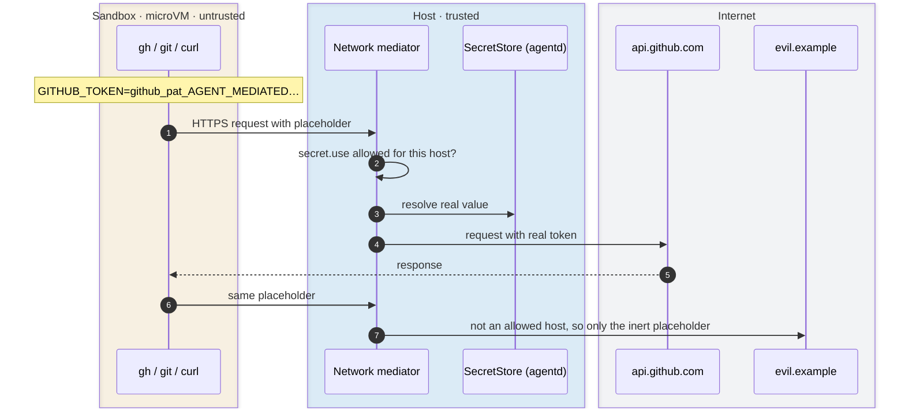
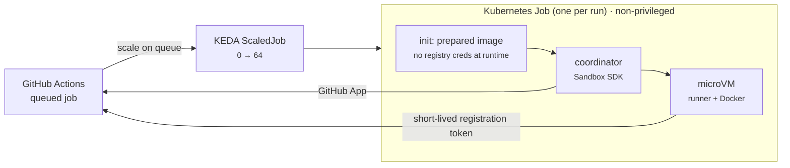

digdir/digdir-agents

# Agents with their own computer

The security view

Security team · Security champions

---

Threat model

# Assume the agent is hostile

<v-clicks>

- An agent runs code **nobody reviewed**: its own, dependencies, scripts from the web
- **Prompt injection** from issues, pages and packages can steer a well-meaning agent
- So we treat it as an attacker with **root inside its VM** and outbound network access
- Without a sandbox, it **runs as you**: your tokens, SSH keys and network

</v-clicks>

  
What we protectassets

  

The host

your machine or the Kubernetes node, its files and its network

  

Secret values

GitHub tokens, model logins, API keys

  

Other agents and jobs

each with its own VM, disk and network

  

Where data goes

which hosts the agent may reach, and with which secrets

---
layout: section
---

Part 1

# The landscape

---
class: tight
---

Linux kernel · CVEs per year

# The kernel CVE flood

  
  
linuxcvetracker.com, NVD data, 21 Oct 2026. Log scale.

  
The same years on a linear scale

  

    

      
263

      

    

    

      
4,355

      

      

    

    

      
5,681

      

      

    

    

      
7,885

      

      

    

  

  

    
2023

2024

    
2025

2026 YTD

  

  
■ Critical: 26 → 47 → 529

  

    <h3 class="c-amber">Read it carefully</h3>
    
Since February 2024 the kernel is its own CVE authority and assigns a CVE to almost every stable fix. Most of the jump is <strong>counting</strong>, not new bugs. The critical count is the signal.

  

---

The Register · 22 July 2026

# "Not feasible to prioritize individual kernel changes"

  

    
432

    <h3>CVEs in two days</h3>
    
Published by the kernel CVE team over one Sunday and Monday in July.

  

  

    
AI

    <h3>Bug hunting at scale</h3>
    
Linus Torvalds, May 2026: the security list has become "almost entirely unmanageable" because of AI-assisted bug hunting.

  

  

    
↻

    <h3>Patch the fleet, not the CVE</h3>
    
Jan Schaumann, Akamai: "This onslaught really shows it's not feasible to attempt to prioritize individual kernel changes."

  

A container shares the host kernel, so every one of these is a potential container escape. 
Triage cannot keep up. The architecture has to limit how much host kernel untrusted code can reach.

---
class: tight
---

CVE-2026-99999 · PwnEscape

# Hypervisors aren't magic either

<v-clicks>

- Found by Paulos Yibelo (pwn.ai) in **Vercel's $1M Sandbox challenge**: the only Critical, on day three
- AI-assisted: **under $700** of API tokens
- The bug is in the **host kernel's network stack**, not in KVM or Firecracker
- The guest sets **checksum metadata** in the virtio-net header. The host kernel trusts it and rewrites an IPv4 header it already validated
- Host memory read on Vercel's production; host root in a matching KVM + Firecracker lab
- CVSS 9.3. Fixed upstream in `6785011f8b16`, stable kernels on 15 October. **No workaround:** patch the host and reboot

</v-clicks>

A VM boundary is only as narrow as the host code the guest can reach.

---
layout: section
---

Part 2

# Our boundary

---

Isolation

# Where a guest's actions land

  
Containershared kernel

  

Untrusted process

  
every syscall ↓

  

Host kernel

every syscall and subsystem, so every kernel CVE

  
gVisoruser-space kernel

  

Untrusted process

  
syscalls ↓

  

Sentry

re-implements Linux in Go

  
reduced set ↓

  

Host kernel

filtered by seccomp

  
microVMours

  

Untrusted process, root

  
syscalls ↓

  

Guest kernel

its own, and untrusted too

  
virtio devices ↓

  

VMM in user space

libkrun, Rust

  
↓

  

Host kernel

KVM + what the VMM calls

The question is never "VM or container?" but which host code does guest-controlled data reach?

---
class: tight
---

Case study · CVE-2026-99999

# The PwnEscape path ends in user space for us

  
TAP / vhost-netFirecracker, many KVM hosts

  

Guest virtio-net

frame + <code>virtio_net_hdr</code> with checksum metadata

  
↓ handed to the host kernel

  

Host kernel · <code>__virtio_net_hdr_to_skb()</code>

guest metadata becomes an <code>skb</code>

  
↓

  

Host IPv4 stack · <code>ip_do_fragment()</code>

header rewritten after validation 💥

  
Microsandboxevery Agent and runner

  

Guest virtio-net

same frame, same header

  
↓ VMM in user space

  

Network backend · header <strong>stripped</strong>

the checksum metadata is thrown away

  
↓

  

smoltcp TCP/IP · authorization · mediator

Rust, in user space

  
↓

  

Host kernel

only sees sockets the host opens itself

We did not predict this bug. The design keeps guest-controlled bytes away from the host kernel, so a whole class of bugs can't be reached. 
AWS: "self-managed KVM hosts using virtio-net/TAP networking can be affected." Microsandbox never selects libkrun's TAP backend.

---

Secrets and egress

# Secrets never enter the Sandbox

Every layer ends on the host · <code>sandbox-authorization</code> for every check · Per-secret <code>allowedHosts</code> · Fails closed

---

agentctl/CHANGELOG.md · Security

# Found and fixed

  

    <h3 class="c-coral">Bypass after an agentd restart</h3>
    
Changing a running Agent's resources after a restart gave it network access around authorization and secret mediation.

  

  

    <h3 class="c-coral">Tunnelling through an allowed host</h3>
    
Non-HTTP traffic inside an HTTPS connection to an allowed host bypassed authorization. WebSockets still work.

  

  

    <h3 class="c-amber"><code>.env</code> in bind mounts</h3>
    
Applying an Agent rejects bind mounts that contain <code>.env</code> files, case-insensitively and regardless of ignore rules.

  

  

    <h3 class="c-amber">TLS dependencies</h3>
    
rustls advisories assessed and upgraded. Certificates chaining through the distrusted emSign intermediates are rejected.

  

The boundary is treated as a security boundary: fixes are released, and the changelog's Security section names them.

CI runs <code>cargo deny</code> for advisories and dependency sources on every change.

---
class: tight
---

Honest limits · host side

# Host attack surface that remains

  

KVMhost kernel

Shared by every KVM product. Patched with the host.

  

VMM deviceslibkrun · Rust

virtio-fs for the root filesystem and bind mounts, block, vsock, console

  

Host-side parsersRust

smoltcp, DNS, TLS termination with rustls, HTTP for authorization and mediation

  

The VMM process isn't confinedgap

It runs as your user with no seccomp filter, Landlock or namespaces. Firecracker ships a jailer and seccomp filters. A VMM bug means code execution as you, on your machine.

  

Kubernetessecond layer

The VMM runs in a non-privileged pod that only gets <code>/dev/kvm</code> from a device plugin.

  

  "Design for the assumption that a guest will eventually escape its first boundary."
  

  
Cloud Security Alliance, research note on PwnEscape

  
<h3>Next layer to add</h3>
Confine the VMM: a seccomp allowlist, Landlock limited to the Agent's own state and mounts, and dropped capabilities. It is cheap compared to a host compromise.

---
class: tight
---

Honest limits · inside the boundary

# What the Sandbox doesn't protect against

  
Protectedby design

  

Your machine

the agent has root only inside its own VM

  

Secret values

never in the VM, only sent to their allowed hosts

  

Other agents

separate VMs, disks and networks

  

The host network

only the Platform API is reachable

  
Not protectedneeds other controls

  

Misuse of a token on its own hosts

anything the PAT allows on github.com, including a public gist

  

Data leaving without secrets

with <code>allow: all</code>, code can be posted to any host

  

Prompt injection

issues, web pages and dependencies can steer the agent

  

Bad code

review is still the gate, not the Sandbox

  

Sessions in one Sandbox

same user and tmux server, so one trust boundary

Narrow tokens, tighter <code>allow</code> lists and review shrink the gap. The policy engine is where stricter rules can go.

---

altinn-studio · src/ci/github-runner

# Same boundary, other workloads

  
<h3>Untrusted PR code</h3>
CI runs whatever a pull request contains. One VM per job, with a private root, workspace and Docker data.

  
<h3>Credentials stay out</h3>
The GitHub App key stays in the coordinator. The guest gets a one-time token and drops it before the runner starts.

  
<h3>Docker without privilege</h3>
Containers run inside the VM instead of in a privileged pod or on a mounted Docker socket.

The Sandbox SDK has no agent concepts. Any workload that runs untrusted code can use the same boundary.

---

Future · not decided

# What's next

  

    
🛡️

    <h3 class="c-sky">Company AI gateway</h3>
    
Send model and MCP traffic through Digdir's gateway: one place for logging, policy and cost. MCP servers are proxied and vetted centrally instead of per agent. Open models for security work on code that must not leave Digdir.

  

  

    
🧩

    <h3 class="c-amber">Plugin architecture</h3>
    
New capabilities as host plugins behind a Platform API. They run on the trusted side with their own authorization, so the Sandbox gets a capability without getting the credentials behind it.

  

  

    
🏭

    <h3 class="c-green">Cloud agents</h3>
    
Software factories: agents started from an issue or a pipeline and run on Kubernetes, like the GitHub runners. The same boundary, at a scale where identity, review and tenancy become the hard questions.

  

---
layout: end
---

Thanks

# Questions?

github.com/digdir/digdir-agents · <code>agentctl/README.md</code> · <code>agentctl/CHANGELOG.md</code> 
github.com/digdir/microsandbox · github.com/digdir/libkrunfw 
Sources: theregister.com · pwn.ai/blog/pwnescape · linuxcvetracker.com · labs.cloudsecurityalliance.org

